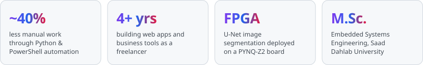
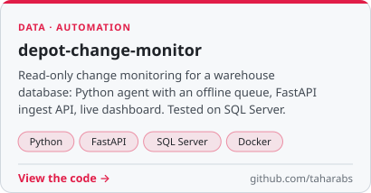
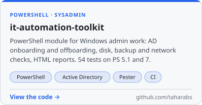
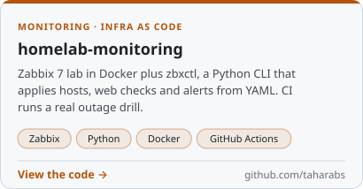
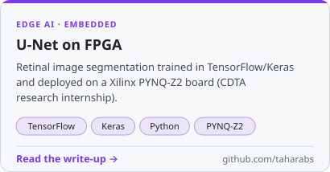
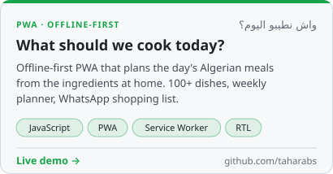
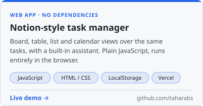
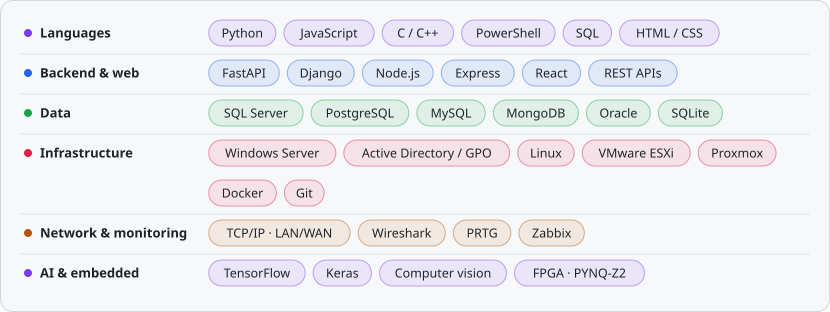

<!-- Profile README for github.com/taharabs — visuals are generated by scripts/build_assets.py -->

<a href="https://taharababsa-techlab.vercel.app/">
  <picture>
    <source media="(prefers-color-scheme: dark)" srcset="https://raw.githubusercontent.com/taharabs/taharabs/main/assets/header-dark.svg">
    
  </picture>
</a>

  &nbsp;
  &nbsp;
  

### About me

I'm an IT engineer who writes software. At **SARL RAMOS**, a printing company in Blida, I run the infrastructure: Windows Server, Active Directory, networks and the prepress (CTP) production line. I also automate the work around it, with Python and PowerShell scripts, ERP data extraction and internal tools. Since 2022 I've built web apps and business software as a freelancer. My engineering background is embedded systems and AI on FPGA.

<picture>
  <source media="(prefers-color-scheme: dark)" srcset="https://raw.githubusercontent.com/taharabs/taharabs/main/assets/impact-dark.svg">
  
</picture>

### Featured work

  <a href="https://depot-change-monitor.vercel.app"><picture><source media="(prefers-color-scheme: dark)" srcset="https://raw.githubusercontent.com/taharabs/taharabs/main/assets/card-depot-monitor-dark.svg"></picture></a>
  <a href="https://github.com/taharabs/it-automation-toolkit"><picture><source media="(prefers-color-scheme: dark)" srcset="https://raw.githubusercontent.com/taharabs/taharabs/main/assets/card-it-toolkit-dark.svg"></picture></a>

  <a href="https://github.com/taharabs/homelab-monitoring"><picture><source media="(prefers-color-scheme: dark)" srcset="https://raw.githubusercontent.com/taharabs/taharabs/main/assets/card-homelab-dark.svg"></picture></a>
  <a href="https://techbytahar.vercel.app/UNet.html"><picture><source media="(prefers-color-scheme: dark)" srcset="https://raw.githubusercontent.com/taharabs/taharabs/main/assets/card-unet-fpga-dark.svg"></picture></a>

  <a href="https://taharabs.github.io/wach-ntayab/"><picture><source media="(prefers-color-scheme: dark)" srcset="https://raw.githubusercontent.com/taharabs/taharabs/main/assets/card-wach-ntayab-dark.svg"></picture></a>
  <a href="https://task-manager-snowy-two.vercel.app"><picture><source media="(prefers-color-scheme: dark)" srcset="https://raw.githubusercontent.com/taharabs/taharabs/main/assets/card-task-manager-dark.svg"></picture></a>

Source code: <a href="https://github.com/taharabs/depot-change-monitor">depot-change-monitor</a> · <a href="https://github.com/taharabs/it-automation-toolkit">it-automation-toolkit</a> · <a href="https://github.com/taharabs/homelab-monitoring">homelab-monitoring</a> · <a href="https://github.com/taharabs/wach-ntayab">wach-ntayab</a> · <a href="https://github.com/taharabs/task-manager">task-manager</a> · <a href="https://github.com/taharabs/site">site</a>

### Experience

| When | Role | Where | What I do |
| :--- | :--- | :--- | :--- |
| 2025 → now | **IT Engineer / Developer** | SARL RAMOS, Blida | Servers, AD & GPO, LAN/WAN and monitoring (PRTG, Wireshark), CTP prepress infrastructure, ERP reporting, Python & PowerShell automation |
| 2022 → now | **Freelance Full-Stack Developer** | Remote | Web apps, REST APIs, databases, web scraping and data extraction, internal business tools |
| 2024 | **AI & Embedded Systems Intern** | CDTA | U-Net retinal image segmentation in TensorFlow/Keras, deployed on a PYNQ-Z2 FPGA |
| 2023 | **Electronics Technician Intern** | ENIE | Electronics and technical systems |

**Education:** M.Sc. Embedded Systems Engineering (2024) · B.Sc. Electronic Engineering (2022), Saad Dahlab University, Blida

### Tech stack

<picture>
  <source media="(prefers-color-scheme: dark)" srcset="https://raw.githubusercontent.com/taharabs/taharabs/main/assets/stack-dark.svg">
  
</picture>

### Right now

- **Just shipped:** [`homelab-monitoring`](https://github.com/taharabs/homelab-monitoring) (Zabbix 7, Python, Docker), after [`depot-change-monitor`](https://github.com/taharabs/depot-change-monitor) and [`it-automation-toolkit`](https://github.com/taharabs/it-automation-toolkit)
- **Building next:** `unet-retinal-fpga`, the training and FPGA deployment code behind my U-Net project
- **Certifying:** Microsoft AZ-104 (Azure Administrator), then PL-300 and RHCSA
- **Completed:** Anthropic courses on the Model Context Protocol, *Claude Code in Action* and *Claude Code 101*
- **Open to:** roles and projects in infrastructure, automation, DevOps and internal tooling

### Contributions

<picture>
  <source media="(prefers-color-scheme: dark)" srcset="https://raw.githubusercontent.com/taharabs/taharabs/output/github-snake-dark.svg">
  
</picture>

<picture>
  <source media="(prefers-color-scheme: dark)" srcset="https://raw.githubusercontent.com/taharabs/taharabs/main/assets/footer-dark.svg">
  
</picture>
